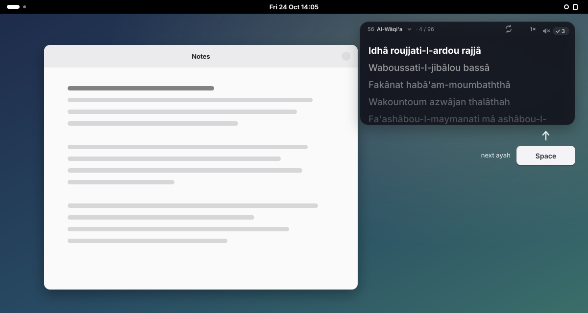
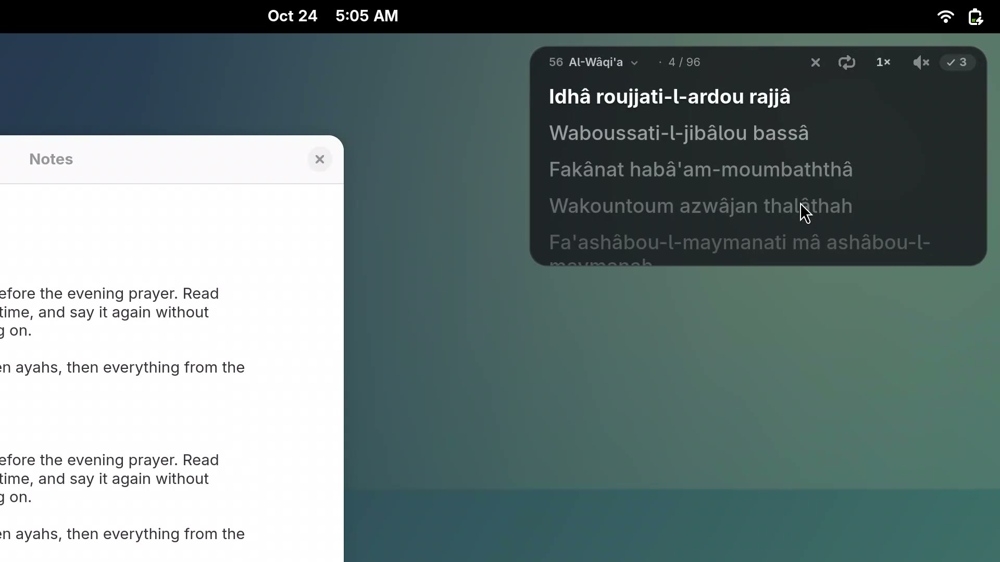
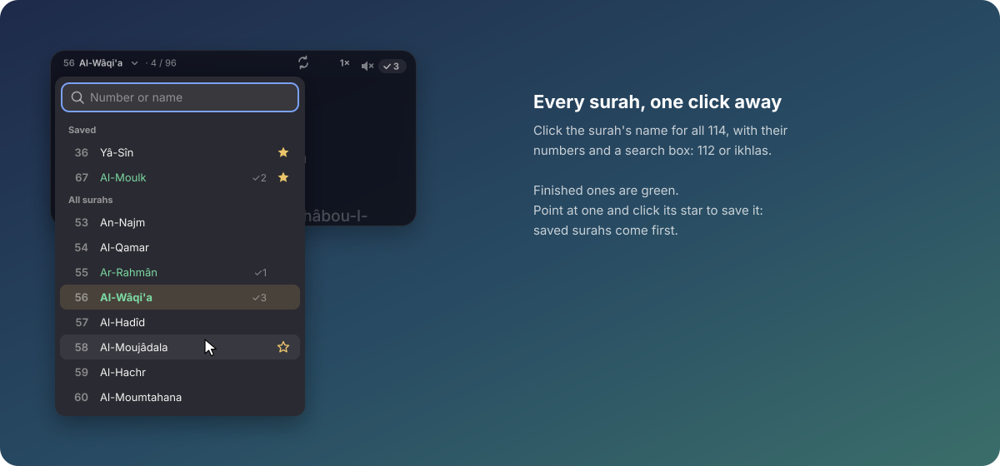
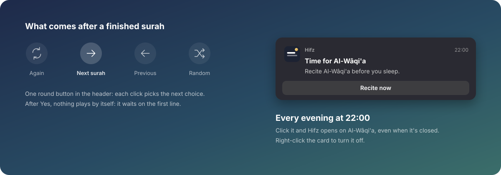
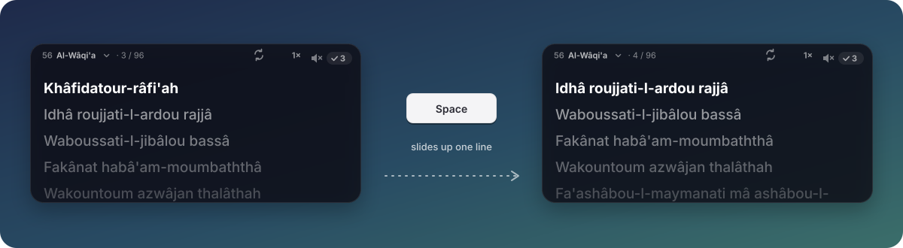
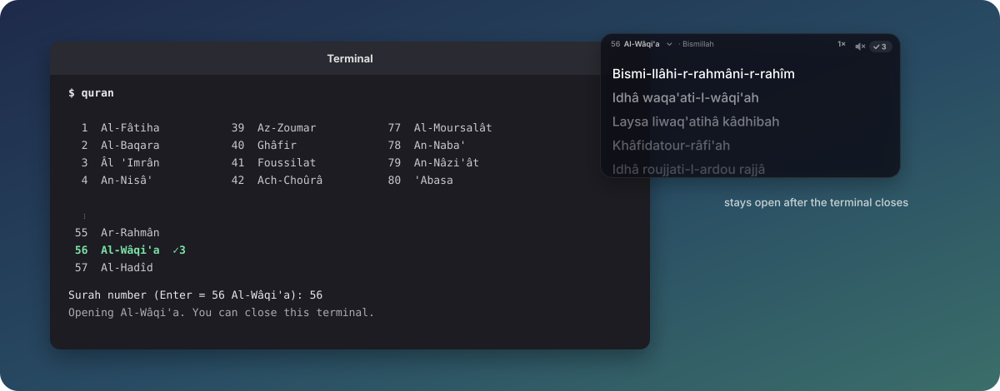
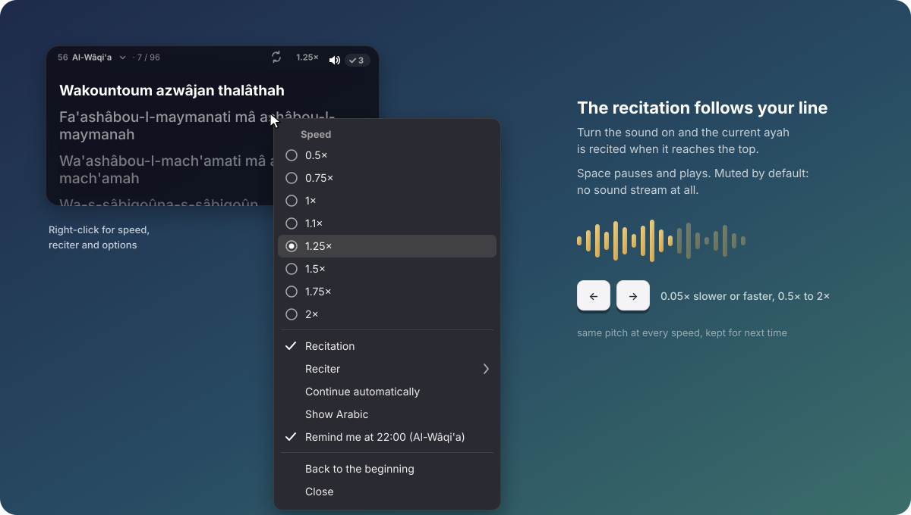
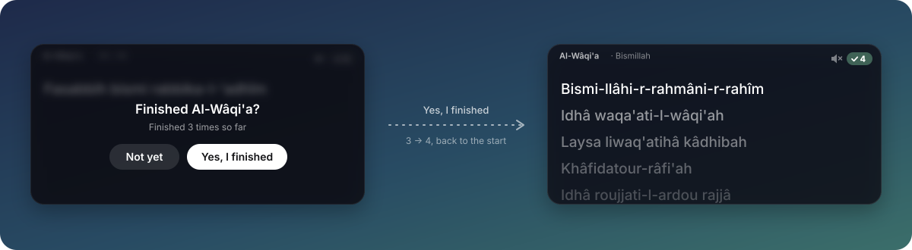

# Hifz

A small Quran prompter for GNOME, for learning a surah by heart. It sits in the top-right
corner of the screen, above your other windows, and shows the surah one ayah at a time in
French phonetics: the current ayah in white at the top, the next ones in grey below. Press
**Space** and the text slides up to the next one. Turn the sound on and the ayah you're on is
recited, at the speed you choose.

<p align="center"></p>

<p align="center"><a href="docs/demo.mp4"></a><br>
<a href="docs/demo.mp4"><b>▶ Watch the demo</b></a> (1:34, with sound)</p>

## What it does

- **One ayah at a time.** The ayah you're on stays at the top in white. The next ones wait
  below in grey, fainter the further they are. **Space** slides everything up by one, smoothly;
  **Backspace** goes back one.
- **Always the same size.** The card is 440 × 212 pixels whatever the surah. Long ayahs wrap,
  and Space first scrolls through a long one before moving on.
- **Always there.** It stays above other windows and on every desktop, in the top-right
  corner, until you close it. It doesn't need the terminal you started it from.
- **French phonetics.** Written the way French phonetic Qurans write Arabic, and the way it is
  recited: *Idhâ waqa'ati-l-wâqi'ah*, *Khâfidatour-râfi'ah*, *Bismi-llâhi-r-rahmâni-r-rahîm*.
  Right-click → **Show Arabic** adds the Arabic under each line.
- **Recitation that follows you.** The sound is off when Hifz opens, and off means no audio
  stream at all, not a quiet one. Turn it on (the speaker, or **M**) and the ayah at the top is
  recited; press Space and the next one starts. With **Continue automatically** the recitation
  carries on without a gap between ayahs, and the text slides as each one begins.
- **Speed.** **→** and **←** change it by 0.05×, from 0.5× to 2×; it's shown next to the
  speaker, where a click opens the list, and it's kept for next time. The voice keeps its
  pitch at every speed.
- **Switch surah from the card.** Click the surah's name (with its number) for a list of all
  114, with a search box: type `112` or `ikhlas` and press Enter. The ones you've finished are
  green. Point at one and click its star to save it: saved surahs come first in the list (and
  get a ★ in `quran`'s list).
- **Counts your rounds.** At the last ayah, Space asks **Finished Al-Wâqi'a?** over the
  blurred text (a gold *Finished? Press Space or scroll* under the last ayah tells you it's
  coming). **Yes** adds one to the small counter in the top-right corner; **Not yet** leaves
  you on the last ayah. Nothing plays by itself afterwards: it waits on the first line.
- **What comes next.** The round button in the header picks what follows a finished surah:
  ↻ the same one again, → the next surah, ← the previous one, or ⤮ a random one (among your
  saved surahs when you have a few). The question says which: *Then 57 Al-Hadîd*.
- **An evening reminder.** Every day at 22:00 a notification says it's time for Al-Wâqi'a;
  clicking it opens Hifz on Al-Wâqi'a, even when Hifz is closed. Right-click →
  **Remind me at 22:00** turns it off and on.
- **Opens where you left off.** Every way of opening it (`quran`, `hifz`, the app grid) brings
  back the surah and the ayah you were on; only the reminder goes to Al-Wâqi'a.

<p align="center"></p>

<p align="center"></p>

<p align="center"></p>

## Start it

Type `quran` in a terminal. It lists the 114 surahs with their numbers; type the number and
press Enter (Enter alone keeps the last one, Al-Wâqi'a the first time). Hifz opens in the
corner and you can close the terminal.

<p align="center"></p>

```bash
quran            # pick from the list
quran 56         # straight to Al-Wâqi'a
quran waqia      # a name works too
quran stats      # how many times you finished each surah
hifz             # open the last surah without asking (also in the app grid)
```

If Hifz is already open, `quran` switches it to the surah you pick. You can also click the
surah's name on the card.

## Keys and menu

Click the card once so it has the keyboard, then:

| Key | Does |
| --- | --- |
| **Space** | Next ayah; with the recitation on, pause and play (at the last ayah, it asks if you finished) |
| ↓, scroll | Next ayah (and recite it, if the sound is on) |
| **Backspace**, ↑ | Previous ayah |
| →, ← | Faster, slower (0.05× a step, from 0.5× to 2×) |
| **M** | Recitation on or off |
| **A** | Show or hide the Arabic |
| **Home** | Back to the beginning |
| **Ctrl+Q** | Close |
| **Enter** / **Esc** | Yes / Not yet, when it asks if you finished |

The mouse wheel moves line by line too. Pointing at the card shows a small × to close it.

<p align="center"></p>

Right-click for the speed, the reciter (Mishary Alafasy by default; also Al-Husary, Al-Minshawi,
Abdul Basit, As-Sudais, Al-Muaiqly, Ash-Shuraim and Ad-Dosari), **Continue automatically**,
**Show Arabic**, **Back to the beginning** and **Close**.

<p align="center"></p>

## Install

Needs GNOME Shell 50 on Wayland (made on Fedora 44), Python 3, GTK 4 and libadwaita, and
GStreamer's good and bad plugins. The installer adds whatever is missing with `dnf`.

```bash
git clone https://github.com/aimanelahssini/hifz
cd hifz
./install.sh
```

Log out and back in once, so GNOME loads the small extension that keeps the window in the
corner, on top and on every desktop. (Wayland apps can't do that themselves.) Without it,
for example on another desktop, Hifz still works as a normal window.

## The phonetics

The text is generated from the Tanzil Uthmani text by [`hifz/phonetic.py`](hifz/phonetic.py),
following how the ayah is recited:

| Written | Sounds like |
| --- | --- |
| **ou** | the Arabic u (*qoul*) |
| **â, î, oû** | long a, i, u |
| **ch, kh, gh** | ش, خ (as in Spanish *jota*), غ (a French r) |
| **th, dh** | ث (English *think*), ذ and ظ (English *this*) |
| **'** | a hamza (a short stop) or a ʿayn, depending on the letter |
| **-** | words joined as they are recited: *bismi-llâhi*, *mina-l-awwalîn* |

The article is assimilated where it is (*ar-rahmân*, *ach-chams*), nûn and tanwîn merge into
the next letter (*khâfidatour-râfi'ah*, *min-ma'în*) or become m before b (*moumbaththâ*), and
the last word of an ayah is in its pausal form (*al-wâqi'ah*, *rajjâ*). It is a help for
reading along with the recitation; checking with the Arabic (**A**) and with a teacher is
still the best way to get every letter right.

## Where things are kept

- **Progress:** `~/.local/state/hifz/progress.json`: the surah you're on, the ayah you're at
  in each surah, how many times you finished each one (with the dates), and your speed,
  reciter and options.
- **Reminder:** a systemd user timer, `~/.config/systemd/user/hifz-reminder.timer`.
- **Recitations:** downloaded once per ayah from [everyayah.com](https://everyayah.com) when
  the sound is on, and kept in `~/.cache/hifz/audio`, so a surah you've listened to works
  offline afterwards.

## Uninstall

```bash
./uninstall.sh          # keeps your progress
./uninstall.sh --all    # removes your progress too
```

## Development

```bash
python3 -m unittest discover tests      # phonetics, against hand-checked ayahs
tests/shell/run.sh                      # the app in a throwaway headless GNOME Shell
tests/shell/demo.sh                     # records docs/demo.mp4 the same way
python3 docs/illustrations.py           # redraws the SVGs in docs/
```

The shell tests never touch your real settings, progress or speakers: everything goes to a
temporary folder and the audio to a fake sink.

## Credits

- Quran text: [Tanzil Project](https://tanzil.net), Uthmani text, used verbatim under
  CC BY 3.0.
- Recitations: [everyayah.com](https://everyayah.com).
- Code: MIT, see [LICENSE](LICENSE).
