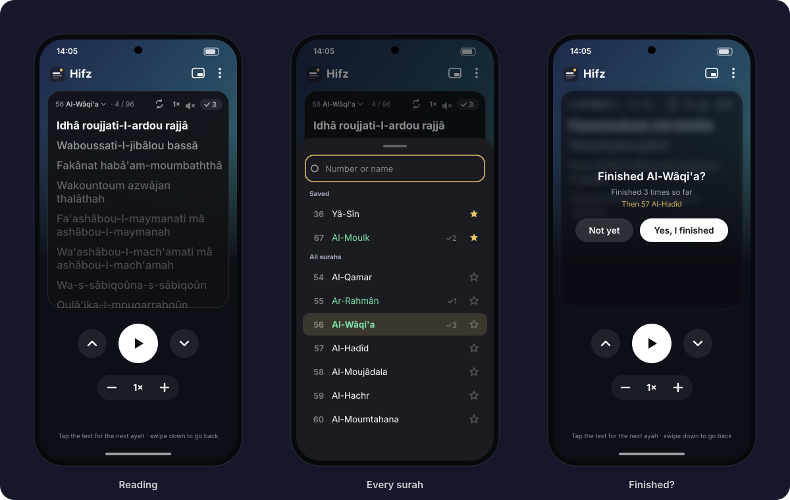
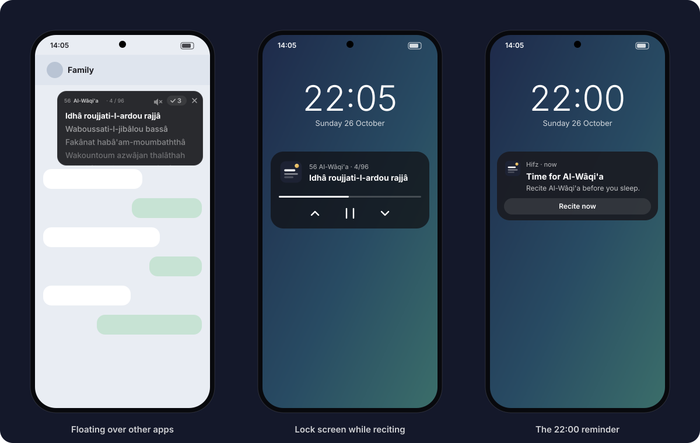
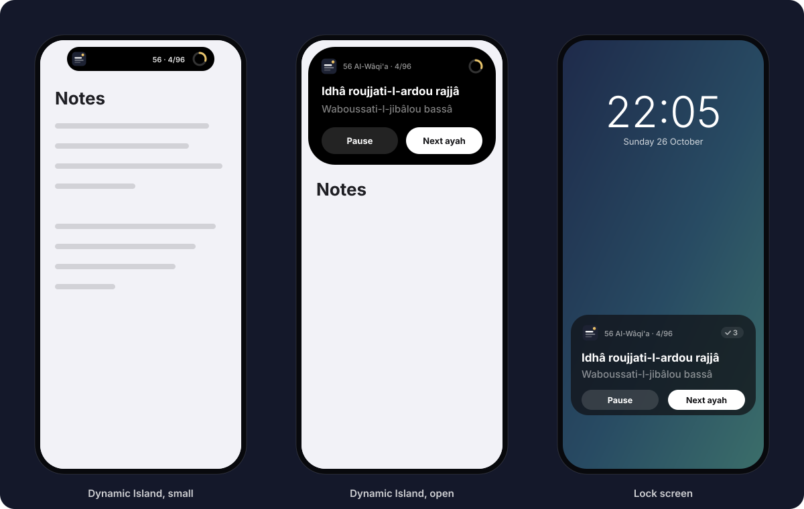

# Hifz for Android and iPhone

**Product requirements.** How the phone apps behave and look. They bring the desktop app to
the phone, and use what each phone does best: a card that floats over other apps on Android,
the Dynamic Island and lock screen on iPhone. How to build them is left to whoever builds them.

## 1. What it is for

Learning a surah by heart, one ayah at a time, wherever you are. You read the ayah you're
on, say it, and move to the next. The recitation can play along. The app remembers where
you are and how many times you finished each surah.

**For whom:** people memorising the Quran who read it more easily in French phonetics,
starting with Al-Wâqi'a, recited every evening.

**What it should feel like:** calm, quiet and dark, never in the way. One thing on screen at
a time, with no ads, no account, no streaks to keep and nothing to set up.

## 2. Principles

1. **The ayah you're on comes first.** It is always at the top in bold white; everything
   else is smaller, greyer or hidden.
2. **One gesture to move on.** A tap or a swipe goes to the next ayah. Nothing needs two steps.
3. **Silence by default.** The app never makes a sound until you ask it to.
4. **It remembers everything.** Close it however you like, and it opens where you were.
5. **Same text, same rules everywhere.** The phonetics, the order of the lines, the finish
   count and the speed steps are exactly those of the desktop app.

## 3. The text

- All 114 surahs, in **French phonetics** as on the desktop: *Idhâ waqa'ati-l-wâqi'ah*,
  *Khâfidatour-râfi'ah*, *Bismi-llâhi-r-rahmâni-r-rahîm*. Words are joined the way they are
  recited, and each ayah ends in the form a reciter stops on.
- **One line per ayah.** Every surah except Al-Fâtiha and At-Tawba opens with the Bismillah
  as a line of its own, before ayah 1.
- **The Arabic** can be shown under each line (a menu option, off at first), right to left,
  in a clear Quranic script.
- The text is in the app: reading never needs a connection.

## 4. The main screen

What you see when you open the app (left in the picture above):

- **Top bar:** the Hifz logo and name; on the right, **Float** (Android) and **⋮** (the menu).
- **The card** takes most of the screen. Its header shows, from left to right:
  - the **surah's number and name** with a small down arrow (tap: the list of every surah);
  - **where you are**: *· 4 / 96*, or *· Bismillah* on the first line;
  - the **end button** (what comes after a finished surah, see 7);
  - the **speed**, e.g. *1×* (tap: the list of speeds);
  - the **speaker**: crossed out when the recitation is off;
  - the **finish count**: a small pill with a check and a number, faint at 0.
- **Under the header, the lines:** the ayah you're on in **bold white**, then the next ones in
  grey, each fainter than the one before, down to the bottom of the card. Long ayahs wrap.
- **Under the card:** **↑** previous ayah, a big round **▶** (the recitation), **↓** next ayah;
  below them, **− 1× +** for the speed.
- **A one-line hint** at the bottom, which changes with the sound:
  *Tap the text for the next ayah · swipe down to go back* or
  *Tap the text to pause or play · swipe up and down to move*.

## 5. Reading

| You do | It does |
| --- | --- |
| Tap the text (sound off) | Next ayah |
| Tap the text (sound on) | Pause, or play on |
| Swipe up, or ↓ | Next ayah (recited if the sound is on) |
| Swipe down, or ↑ | Previous ayah |
| Tap the text on the last ayah | Asks whether you finished (see 6) |

- **Moving is a slide, not a jump.** The whole text slides up by one ayah in about 0.4 s,
  slowing down at the end. The new ayah turns bold white as it reaches the top, the one you
  left fades out above, and the grey lines below brighten one step.
- **Long ayahs:** when an ayah is taller than the card, the first tap scrolls through it,
  and only the next one moves on.
- **The card never changes size**, whatever the surah or the ayah.
- **The line under the last ayah** says, in gold italics, *Finished? Tap or swipe up*.

## 6. Finishing a surah

- On the last ayah, moving on brings up a question **over the blurred card**:
  **Finished Al-Wâqi'a?**, with *Finished 3 times so far* (or *It will count as your first
  time*), and in gold what comes next: *Then from the start* or *Then 57 Al-Hadîd*.
- **Not yet** closes the question and stays on the last ayah.
- **Yes, I finished** adds one to the count (the pill flashes green for a moment), keeps the
  date, and opens what comes next **on its first line, waiting**: nothing plays by itself,
  even if the recitation was on. A tap starts again.

## 7. What comes after a finished surah

The **end button** in the card's header cycles through four choices, one per tap. Its icon
shows the current one, and its name appears for a moment where the ayah number is:

| Icon | Choice | After *Yes, I finished* |
| --- | --- | --- |
| ↻ | Again *(first)* | The same surah, from the start |
| → | Next | The next surah (after 114 comes 1) |
| ← | Previous | The previous surah (before 1 comes 114) |
| ⤮ | Random | A random surah: among your saved ones when you have at least two, otherwise any; never the same one |

## 8. Every surah

Tapping the surah's name opens a list from the bottom of the screen (middle picture at the top):

- A **search box** at the top: a number (*112*) or part of a name, with or without accents
  (*ikhlas*, *waqia*, *Al-Waqiah*). The keyboard opens only when you tap the box.
- **Saved** surahs first, under *Saved*, then *All surahs*.
- Each row: the **number** (faint), the **name**, **✓3** if you finished it, and a **star**.
  - The surah you're reading has a soft gold background.
  - Surahs you've finished have their **name in green**; the others are plain white.
  - The **star** saves a surah (gold) or removes it (outline). Tapping it doesn't open the surah.
- Tapping a row opens that surah **where you left it** and closes the list.
- The list opens on your saved surahs if you have some, otherwise around the one you're reading.

## 9. The recitation

- **Off when the app opens.** Off means silent and invisible: no sound, no media controls,
  nothing in the notifications.
- **The big ▶** (or the speaker) turns it on. The ayah you're on is recited; when it ends, the
  app waits for you. Moving to an ayah recites it.
- **Continue automatically** (menu): the recitation goes on by itself, ayah after ayah,
  **with no gap between them**, and the text slides as each one begins. On the last ayah it
  asks whether you finished.
- **Speed:** from 0.5× to 2× in steps of 0.05, with **−** and **+**, or from the speed list
  in the header (it opens on your current speed). The voice keeps its natural pitch at every
  speed, and changes take effect at once, mid-ayah. The speed is kept for next time.
- **Reciters** (menu): Mishary Alafasy (first), Mahmoud Khalil Al-Husary, Mohamed Siddiq
  Al-Minshawi, Abdul Basit Abdul Samad, Abdul Rahman Al-Sudais, Maher Al-Muaiqly, Saud
  Al-Shuraim, Yasser Al-Dosari.
- **Offline:** each ayah is downloaded the first time it's played and kept. A surah you've
  listened to plays without a connection afterwards. With no connection and nothing kept, the
  speaker shows a small *no connection* sign, and a tap tries again.
- **With the screen off, or in another app:** it keeps playing. The lock screen and the
  phone's media controls show **the ayah being recited** as the title and *56 Al-Wâqi'a ·
  4/96* below, with previous, pause/play and next, which move the text in the app too.
- **Interruptions:** a call, another app's sound or unplugged headphones pause it, as any
  player would.

## 10. The evening reminder

- **Every day at 22:00**, a notification: **Time for Al-Wâqi'a**, *Recite Al-Wâqi'a before
  you sleep.*, with a **Recite now** button.
- Tapping it, or the button, opens the app **on Al-Wâqi'a, where you left it**, even when the
  app was closed.
- **On at first**, and switched off and on from the menu: *Remind me at 22:00 (Al-Wâqi'a)*.
- It keeps working after the phone restarts, and follows the phone's time when you travel.

## 11. Opening where you left off

- Every way of opening the app (its icon, the lock screen controls, the floating card) brings
  back the **same surah at the same ayah**. Only the reminder goes to Al-Wâqi'a.
- Each surah keeps its own place: switching to another surah and back returns to where you were.
- Kept for good on the phone: the place in each surah, how many times each was finished and
  when, saved surahs, speed, reciter and options. Nothing is sent anywhere.

## 12. The menu (⋮)

*Reciter* (a list) · *Continue automatically* ✓ · *Show Arabic* ✓ · *Remind me at 22:00
(Al-Wâqi'a)* ✓ · *Back to the beginning* (the first line of the surah, without counting it as
finished).

## 13. Android only

### Floating over other apps

The phone version of the desktop card in its corner (first picture in section 6).

- **Float** in the top bar shrinks the card into a **small floating card** (about 320 × 170
  points) **on top of every app**, and goes back to the home screen.
- The floating card shows the header (number and name, where you are, speaker, finish count,
  **×**) and three or four lines. It behaves like the big card: **tap** the text as in section 5,
  **swipe** up and down to move.
- **Drag it by its header** anywhere on the screen; it stays where you put it, next time too.
- **Tap the surah's name, or press and hold the text,** to open the app (the floating card
  closes). **×** closes it.
- While it floats, a quiet notification says *Hifz is floating* with **Close**.
- The first time, the phone asks to allow **Display over other apps**. Hifz explains why in
  one sentence and opens the right setting; once it's allowed, the card floats straight away.

### Lock screen and status bar

While it recites: the lock screen and media controls as in section 9. On phones that have
them, a live chip in the status bar shows *56 · 4/96* while it recites.

### Getting it

Downloaded from the project's page on GitHub as an app file, with no store. The first time,
Android asks to allow installing it ("Install unknown apps") and may warn about an unknown
app. Each new version installs over the old one and keeps everything. The page explains
these steps with pictures.

## 14. iPhone only

### Dynamic Island

While the recitation is on, and for a while after you leave the app during a reading:

- **Small:** the Hifz logo on the left; on the right *56 · 4/96* and a thin gold ring that
  fills as the surah goes on.
- **Open** (press and hold the island): the surah and where you are, the ayah you're on in
  bold white, the next one in grey, and two buttons, **Pause** (or **Play**) and **Next ayah**.
  They work without opening the app.
- Tapping the island opens the app where you are.

### Lock screen

The same as the open island, as a card on the lock screen, with the finish count. It
disappears when the recitation is turned off, or a few minutes after the last move without
sound.

### Floating text (optional, second version)

A small floating window, like a video in picture-in-picture, showing the current ayah and
the next one over other apps, moving on with a tap. To be done only if it's allowed on the
App Store.

### Getting it

First through a test link (an invitation to install the test version), then on the App Store.

## 15. How it looks

- **Colours:** a near-black background (#0D0F17). The card is a very dark grey (#101014)
  with a faint light border. At the top of the main screen, a soft gradient from deep blue
  (#1E2A4A) to teal (#3B6E6A) fades into the background.
- **Accents:** **gold** (#E9C46A) for what comes next (the finish line, *Then …*, the current
  surah in the list, saved stars) and **green** (#7EE2A8) for finished (names in the list,
  the count's flash).
- **Text:** the ayah you're on is bold white; the next ones are white at 56 %, 44 %, 33 % and
  24 % brightness; the header is small and grey. The ayah text is large (about 22 points on
  the big card, 17 on the floating one), with room between lines.
- **Shapes:** the card and floating card have large rounded corners; buttons are round; the
  question's buttons are pills (**Yes, I finished** white with dark text, **Not yet** dark).
- **Motion:** slides of about 0.4 s that slow down at the end, fades of about 0.35 s, the
  green flash about 1 s. Nothing bounces. With "reduce motion" on, moves are instant.
- **App icon:** the desktop logo: a dark rounded square with a white line, two grey lines
  below, and a gold check badge. It also comes as a single-colour icon for themed home screens.
- **Always dark**, whatever the phone's setting.

## 16. Words on screen

English, as on the desktop: *Finished Al-Wâqi'a?* · *It will count as your first time* ·
*Finished 3 times so far* · *Then from the start* · *Then 57 Al-Hadîd* · *Not yet* · *Yes,
I finished* · *Finished? Tap or swipe up* · *Number or name* · *Saved* · *All surahs* ·
*Time for Al-Wâqi'a* · *Recite Al-Wâqi'a before you sleep.* · *Recite now* · *Hifz is
floating* · *Continue automatically* · *Show Arabic* · *Remind me at 22:00 (Al-Wâqi'a)* ·
*Back to the beginning*. The phonetics are French; the menus could be translated to French
later.

## 17. Accessibility

- Every button has a spoken name for screen readers (*Next ayah*, *Recitation off*, *Save
  Al-Wâqi'a*, *Finished 3 times*).
- The text follows the phone's text size up to a point; the card grows in height rather
  than cutting text off.
- Contrast: the ayah you're on is white on near-black; grey lines are for what comes later,
  never for what you need to read now.
- Everything works with one hand, from the bottom half of the screen.

## 18. The first time

1. The app opens on **Al-Wâqi'a, Bismillah**, sound off.
2. It asks once for permission to send notifications, for the 22:00 reminder.
3. Nothing else: no sign-up, no tour. The hint line explains the gestures.

## 19. It's right when

- [ ] It opens on Al-Wâqi'a the first time, and afterwards always where you left off.
- [ ] A tap moves on by one ayah with a smooth slide; a swipe down goes back.
- [ ] Nothing makes a sound until the recitation is turned on.
- [ ] With *Continue automatically*, ayahs follow each other with no audible gap, at every
      speed from 0.5× to 2×, and the text keeps pace.
- [ ] The speed changes by 0.05, keeps the voice's pitch, and is the same after a restart.
- [ ] *Yes, I finished* adds one to the count and opens the next surah (as the end button
      says) on its first line, silent.
- [ ] The surah list finds *112*, *ikhlas* and *waqia*; finished surahs are green; stars save.
- [ ] The 22:00 notification arrives every day, also after a restart, and opens Al-Wâqi'a.
- [ ] A surah heard once plays again in airplane mode.
- [ ] Android: the floating card stays over other apps, moves with a tap, can be dragged and
      closed, and comes back where it was.
- [ ] iPhone: the Dynamic Island shows the surah and where you are; open, its **Next ayah**
      and **Pause** work without opening the app; the lock screen shows the same.
- [ ] The longest surah (Al-Baqara, 287 lines) opens, scrolls and recites smoothly.

## 20. Not now

- Progress shared between the laptop and the phones.
- Home screen widgets, watch apps, CarPlay and Android Auto.
- Translations (meaning) of the ayahs, and other phonetic styles.
- Accounts, streaks, statistics screens or sharing.
